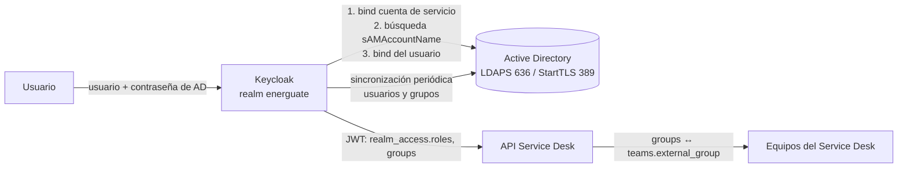

# Integración con el Active Directory de Energuate

El Service Desk no habla directamente con el AD: **Keycloak** federa los usuarios del AD (solo
lectura) y emite los tokens OIDC que consumen el portal y la API. Toda la configuración la aplica
de forma idempotente el contenedor one-shot `keycloak-config` (`keycloak/configure-ldap.sh`) a
partir de variables `LDAP_*` del archivo `.env`; no hay credenciales en el repositorio.



## 1. Qué se necesita del equipo de AD

| Elemento | Ejemplo | Notas |
|---|---|---|
| Controlador(es) de dominio | `dc01.energuate.local` | Nombre que coincida con el certificado (SAN). Varios: `ldaps://dc01:636 ldaps://dc02:636` (separados por espacio). |
| Protocolo | LDAPS (636) o LDAP + StartTLS (389) | **Obligatorio cifrado.** En producción `LDAP_ALLOW_INSECURE` está fijado a `false`. |
| CA corporativa | `energuate-root-ca.pem` (+ intermedias) | Para validar el certificado de los DC. |
| Cuenta de servicio | `CN=svc-servicedesk-ldap,OU=Servicios,DC=energuate,DC=local` | **Solo lectura**, contraseña que no expire (o con proceso de rotación), sin derechos de inicio de sesión interactivo. |
| DN base de usuarios | `OU=Usuarios,DC=energuate,DC=local` | Se recorre con alcance `subtree` (configurable). |
| DN base de grupos | `OU=Grupos,OU=ServiceDesk,DC=energuate,DC=local` | Donde viven los grupos `GG-SD-*`. |
| Grupos de rol | `GG-SD-Admins`, `GG-SD-Agentes`, `GG-SD-Aprobadores` | Dan los roles de la aplicación. |
| Grupos de equipo | `GG-SD-Telecomunicaciones`, `GG-SD-SeguridadRedes`, `GG-SD-SOC`, `GG-SD-Riesgo`, `GG-SD-ProyectosTI`, `GG-SD-General` | Asignan al agente a su equipo/departamento. |

### Permisos de la cuenta de servicio

Basta con un usuario de dominio estándar (los usuarios autenticados pueden leer el directorio por
defecto). Recomendaciones:

- Miembro únicamente de `Domain Users`; **no** administrador ni operador de cuentas.
- "La cuenta es confidencial y no se puede delegar"; denegar inicio de sesión local y por RDP (GPO).
- Si se usan ACL restrictivas, conceder lectura sobre `sAMAccountName`, `cn`, `givenName`, `sn`,
  `mail`, `userPrincipalName`, `objectGUID`, `memberOf`, `member`, `userAccountControl`,
  `whenCreated`, `whenChanged` en las OU de usuarios y grupos.
- Keycloak opera en modo `READ_ONLY`: nunca escribe en el AD, y los cambios de contraseña se hacen
  en el AD (no desde Keycloak).

## 2. Mapeo de atributos

| Keycloak | AD | Comentario |
|---|---|---|
| Username | `sAMAccountName` | Lo que escribe el usuario al iniciar sesión (sin dominio). |
| RDN | `cn` | |
| UUID (identificador estable) | `objectGUID` | No cambia aunque se renombre o mueva la cuenta. Es el `sub` del token → `users.keycloak_sub`. |
| Clases de objeto | `person, organizationalPerson, user` | |
| Nombre / Apellido / Correo | `givenName` / `sn` / `mail` | Mappers por defecto del vendor `ad`. |
| Grupos | `group-ldap-mapper` (`cn`, membresía `member`) | READ_ONLY, sin jerarquía (`groups.path=/`). |

El inicio de sesión también acepta el correo (`loginWithEmailAllowed`).

## 3. Configuración (`.env`)

```dotenv
# LDAPS (recomendado)
LDAP_URL=ldaps://dc01.energuate.local:636
LDAP_START_TLS=false
# ...o StartTLS:
# LDAP_URL=ldap://dc01.energuate.local:389
# LDAP_START_TLS=true

LDAP_BIND_DN=CN=svc-servicedesk-ldap,OU=Servicios,DC=energuate,DC=local
LDAP_BIND_CREDENTIAL=********            # solo en .env del servidor
LDAP_USERS_DN=OU=Usuarios,DC=energuate,DC=local
LDAP_GROUPS_DN=OU=Grupos,OU=ServiceDesk,DC=energuate,DC=local

# Solo cuentas habilitadas (bit ACCOUNTDISABLE de userAccountControl)
LDAP_USER_FILTER='(!(userAccountControl:1.2.840.113556.1.4.803:=2))'
# Opcional: solo miembros de algún grupo del Service Desk (incluye anidados)
# LDAP_USER_FILTER='(&(!(userAccountControl:1.2.840.113556.1.4.803:=2))(memberOf:1.2.840.113556.1.4.1941:=CN=GG-SD-Usuarios,OU=Grupos,OU=ServiceDesk,DC=energuate,DC=local))'
LDAP_GROUP_FILTER='(cn=GG-SD-*)'
LDAP_GROUPS_RECURSIVE=false              # true = resuelve grupos anidados (LDAP_MATCHING_RULE_IN_CHAIN)

LDAP_SEARCH_SCOPE=subtree
LDAP_PAGINATION=true                     # AD limita a 1000 resultados por página
LDAP_BATCH_SIZE=500
LDAP_CONNECTION_TIMEOUT=10000            # ms
LDAP_READ_TIMEOUT=30000                  # ms
LDAP_FULL_SYNC_PERIOD=86400              # s (-1 desactiva)
LDAP_CHANGED_SYNC_PERIOD=3600            # s (-1 desactiva)
LDAP_SYNC_USERS_ON_START=false           # true = importa todos al ejecutar keycloak-config

KC_GROUP_ROLE_MAP=GG-SD-Admins:admin,GG-SD-Agentes:agent,GG-SD-Aprobadores:approver
SEED_TEAM_GROUPS="Telecomunicaciones:GG-SD-Telecomunicaciones,Seguridad de Redes:GG-SD-SeguridadRedes,Ciberseguridad / SOC:GG-SD-SOC,Riesgo y Cumplimiento:GG-SD-Riesgo,Proyectos TI:GG-SD-ProyectosTI,General:GG-SD-General"
```

Notas:
- Los filtros deben ir entre paréntesis y, en `.env`, entre comillas simples.
- `$` en la contraseña: escríbala entre comillas simples o duplique el símbolo (`$$`).
- `LDAP_USER_FILTER` también aplica al login: una cuenta deshabilitada en AD deja de poder
  entrar de inmediato, aunque siga importada en Keycloak.

## 4. Certificado de la CA corporativa (LDAPS / StartTLS)

Keycloak valida el certificado de los DC con su *truststore*. **No** desactive la validación.

1. Obtenga la CA raíz (y las intermedias) en PEM. Desde un equipo del dominio:
   ```powershell
   certutil -ca.cert energuate-root-ca.cer
   certutil -encode energuate-root-ca.cer energuate-root-ca.pem
   ```
   o desde Linux, para ver la cadena que presenta el DC:
   ```bash
   openssl s_client -connect dc01.energuate.local:636 -showcerts </dev/null
   ```
2. Copie el/los `.pem` en `keycloak/truststore/` (o en la carpeta de `KC_TRUSTSTORE_DIR`). La carpeta
   no se versiona.
3. Reinicie Keycloak y reaplique la configuración:
   ```bash
   docker compose -f docker-compose.prod.yml restart keycloak
   docker compose -f docker-compose.prod.yml up keycloak-config
   ```

Keycloak carga la carpeta mediante `KC_TRUSTSTORE_PATHS=/opt/keycloak/conf/truststores`
(archivos `.pem`, `.crt`, `.p12`, `.pfx`) y el proveedor LDAP usa `useTruststoreSpi=always`. El nombre
de `LDAP_URL` debe coincidir con el CN/SAN del certificado del DC (no use la IP).

## 5. Aplicar y probar

```bash
# Producción
docker compose -f docker-compose.prod.yml up keycloak-config
docker compose -f docker-compose.prod.yml logs keycloak-config
# Laboratorio
docker compose up keycloak-config && docker compose logs keycloak-config
```

Salida esperada:

```
[keycloak-config] federación LDAP 'energuate-ad' creada (id …)
[keycloak-config] mapper de grupos 'groups-ad' creado (id …)
[keycloak-config] prueba de conexión y bind contra AD: correcta
[keycloak-config] grupos sincronizados desde AD: …
[keycloak-config] grupo 'GG-SD-Admins' -> rol 'admin'
[keycloak-config] configuración de Keycloak completada
```

El script valida antes de aplicar: esquema `ldap://`/`ldaps://`, StartTLS incompatible con
`ldaps://`, cifrado obligatorio, filtros entre paréntesis, enteros válidos y que no queden valores
`replace-...`. Si la prueba de conexión falla, deja la federación creada (Keycloak reintenta) e
informa del motivo.

### Prueba de un usuario real

1. Abra `https://<APP_DOMAIN>/` e inicie sesión con un usuario de AD (sAMAccountName).
2. Verifique en el portal (menú de usuario) sus roles y equipos, o con la API:
   ```bash
   SD_KEYCLOAK_URL=https://<APP_DOMAIN>/auth SD_WEB_URL=https://<APP_DOMAIN> \
     scripts/get-test-token.sh -u jperez --claims
   ```
   El token debe contener `aud: servicedesk-api`, `realm_access.roles` (p. ej. `agent`) y
   `groups` (p. ej. `["GG-SD-Agentes","GG-SD-SOC"]`).
3. La API crea el usuario en su primer acceso (JIT) y lo asigna a los equipos cuyo
   `teams.external_group` coincide con sus grupos.

### Prueba de conectividad desde el host (sin Keycloak)

```bash
# Resolución y puerto
getent hosts dc01.energuate.local && nc -vz dc01.energuate.local 636
# Certificado y cadena (debe terminar en "Verify return code: 0 (ok)" con la CA corporativa)
openssl s_client -connect dc01.energuate.local:636 -CAfile keycloak/truststore/energuate-root-ca.pem </dev/null
# Búsqueda con la cuenta de servicio (paquete ldap-utils)
LDAPTLS_CACERT=keycloak/truststore/energuate-root-ca.pem ldapsearch -H ldaps://dc01.energuate.local \
  -D 'CN=svc-servicedesk-ldap,OU=Servicios,DC=energuate,DC=local' -W \
  -b 'OU=Usuarios,DC=energuate,DC=local' '(sAMAccountName=jperez)' sAMAccountName memberOf
```

## 6. Roles y equipos

- **Roles** (`KC_GROUP_ROLE_MAP`): cada grupo recibe un rol de realm. Todo usuario autenticado tiene
  además `requester` (rol por defecto del realm). Un usuario en `GG-SD-Agentes` y `GG-SD-SOC` obtiene
  `agent` y queda en el equipo SOC.
- **Equipos** (`SEED_TEAM_GROUPS` → `teams.external_group`): la API sincroniza `team_members` en cada
  petición según el claim `groups` (sin ruta completa). Si el usuario sale de todos los grupos,
  Keycloak omite el claim y la API retira sus membresías mapeadas (`OIDC_MISSING_GROUPS_AS_EMPTY`).
  Un administrador puede cambiar el grupo de un equipo desde *Administración → Equipos*.
- Los grupos se crean en Keycloak si no existen; cuando el AD sincroniza un grupo con el mismo nombre,
  Keycloak reutiliza el grupo existente (y conserva su rol).

Para añadir un área nueva: cree el grupo en AD (`GG-SD-<Área>`), cree el equipo en la aplicación con
ese `external_group`, y ejecute `keycloak-config` (o espere a la sincronización periódica).

## 7. Sincronización

| Tipo | Periodo | Variable |
|---|---|---|
| Completa (usuarios) | 24 h | `LDAP_FULL_SYNC_PERIOD` |
| Cambios (`whenChanged`) | 1 h | `LDAP_CHANGED_SYNC_PERIOD` |
| Grupos | al ejecutar `keycloak-config` y con cada sincronización | — |
| Al iniciar sesión | siempre | Keycloak consulta el AD en cada login (contraseña y estado). |

Sincronización manual: consola de Keycloak → realm `energuate` → *User federation* →
`energuate-ad` → *Synchronize all users*; grupos: *Mappers* → `groups-ad` → *Sync LDAP groups to
Keycloak*. (La consola solo es accesible desde `ADMIN_ALLOWED_CIDRS`.)

Bajas: al deshabilitar la cuenta en AD, el usuario no puede iniciar sesión (filtro + bind). Las
sesiones activas expiran como máximo en `ssoSessionIdleTimeout` (30 min); para cortar
inmediatamente, cierre sus sesiones en Keycloak (*Users → Sessions → Sign out*).

## 8. Solución de problemas

| Síntoma (logs de `keycloak-config` / `keycloak`) | Causa probable | Acción |
|---|---|---|
| `PKIX path building failed` / `unable to find valid certification path` | Falta la CA en el truststore | Copie la CA raíz e intermedias (PEM) en `keycloak/truststore/` y reinicie Keycloak. |
| `No subject alternative DNS name matching` | `LDAP_URL` usa IP o un alias que no está en el certificado | Use el FQDN del DC que aparece en el SAN. |
| `Connection refused` / `timeout` | Firewall o DNS | Abra 636/389 desde el servidor hacia los DC; pruebe con `nc -vz`. El contenedor sale por la red `egress`. |
| `LDAP: error code 49 - 80090308 … data 52e` | Credenciales de la cuenta de servicio incorrectas | Revise `LDAP_BIND_DN` (DN completo o `usuario@dominio`) y la contraseña. |
| `data 532` / `data 773` / `data 775` | Contraseña expirada / debe cambiarse / cuenta bloqueada | Corrija la cuenta de servicio en AD. |
| `Sizelimit exceeded` | Paginación desactivada | `LDAP_PAGINATION=true`. |
| Usuario entra pero sin rol `agent` | No está en el grupo o el grupo no está bajo `LDAP_GROUPS_DN` / no cumple `LDAP_GROUP_FILTER` | Verifique `memberOf`; sincronice grupos; revise `KC_GROUP_ROLE_MAP`. |
| Grupos anidados no aplican | Estrategia sin recursión | `LDAP_GROUPS_RECURSIVE=true`. |
| Usuario no aparece en su equipo | `groups` del token no coincide con `teams.external_group` | Compare con `get-test-token.sh --claims`; ajuste el equipo en Administración. |
| `una variable LDAP_* conserva el valor de ejemplo` | `.env` con `replace-...` | Complete los valores o deje `LDAP_URL=` vacío para omitir AD. |
| `ldap:// sin StartTLS envía la contraseña … en claro` | Falta cifrado | Use `ldaps://` o `LDAP_START_TLS=true`. |

Logs detallados de LDAP (temporalmente): `KC_LOG_LEVEL=info,org.keycloak.storage.ldap:debug` y
`docker compose … up -d keycloak`. Vuelva a `info` al terminar: el nivel debug puede registrar DN y
atributos de usuarios.

## 9. Laboratorio sin AD

Con `LDAP_URL` vacío no se crea federación. Para pruebas, `KC_LAB_USERS=true` (solo en
`docker-compose.yml`) crea usuarios locales con los grupos anteriores: `demo.admin`, `ana.telecom`,
`luis.soc`, `rosa.redes`, `marta.aprobadora`, `carlos.solicitante` y `sofia.solicitante` (contraseña
`KC_LAB_PASSWORD`). En producción `KC_LAB_USERS` está fijado a `false` y esos usuarios se
deshabilitan si existieran.
