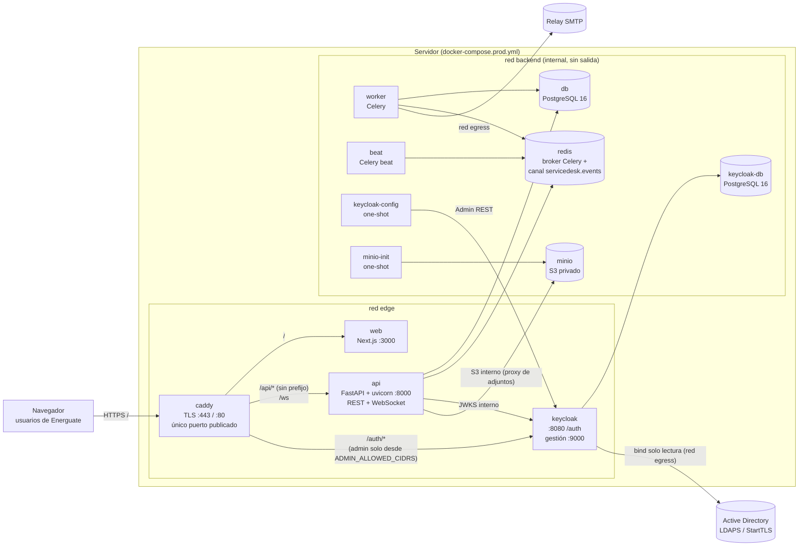
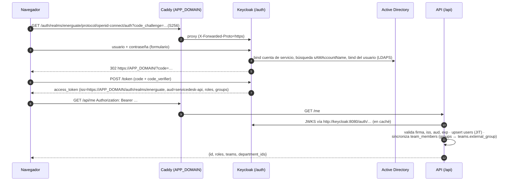
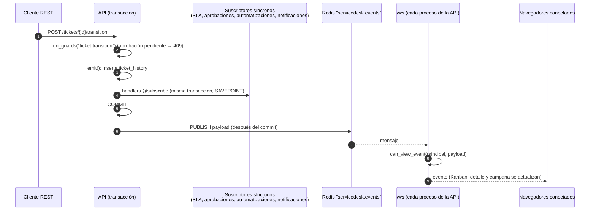
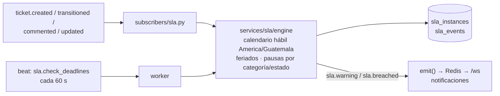

# Arquitectura

## Vista general (producción)

En laboratorio (`docker-compose.yml`) no hay Caddy: cada servicio publica su puerto en
`127.0.0.1` (web 3000, api 8000, Keycloak 8081, MinIO 9000/9001) y Keycloak corre con `start-dev`.

| Servicio | Imagen | Prod: publicado | Lab: publicado | Healthcheck |
|---|---|---|---|---|
| `caddy` | caddy:2.10-alpine | 80, 443 (tcp+udp) | — | `:8088/healthz` interno |
| `web` | build `./frontend` | — | 127.0.0.1:3000 | `GET /` |
| `api` | build `./backend` | — | 127.0.0.1:8000 | `GET /health` (incluye BD) |
| `worker` | build `./backend` | — | — | prod: `celery inspect ping` |
| `beat` | build `./backend` | — | — | — (una sola instancia) |
| `db` | postgres:16-alpine | — | — | `pg_isready` |
| `redis` | redis:7-alpine | — | — | `redis-cli ping` (prod con contraseña) |
| `keycloak-db` | postgres:16-alpine | — | — | `pg_isready` |
| `keycloak` | quay.io/keycloak/keycloak:26.1 | — | 127.0.0.1:8081 | `/health/ready` en :9000 |
| `keycloak-config` | quay.io/keycloak/keycloak:26.1 | — | — | one-shot (exit 0) |
| `minio` | Chainguard MinIO (digest fijo) | — | 127.0.0.1:9000/9001 | `/minio/health/live` |
| `minio-init` | Chainguard minio-client | — | — | one-shot (exit 0) |

Diferencias de producción: Keycloak en `start` (no `start-dev`) con `KC_HTTP_RELATIVE_PATH=/auth`,
`KC_PROXY_HEADERS=xforwarded` y proxies de confianza; MinIO sin consola; Redis con contraseña;
límites de CPU/RAM; logs con rotación; valores de seguridad fijados (`AUTH_MODE=oidc`,
`SEED_DEMO=false`, `KC_LAB_USERS=false`, `ENVIRONMENT=production`). Ver [DEPLOYMENT.md](DEPLOYMENT.md).

### Arranque

`db`, `redis`, `keycloak-db`, `minio` → `keycloak` (importa `keycloak/realm-energuate.json` si el
realm no existe) → `keycloak-config` y `minio-init` → `api` (`alembic upgrade head` → seeds →
uvicorn) → `worker`, `beat`, `web` → `caddy`. `worker` y `beat` esperan a que `api` esté sana para
no competir con las migraciones.

### Backend

FastAPI con descubrimiento automático: cada `app/routers/*.py` expone `router`; `app/models/*`,
`app/subscribers/*` y `app/tasks/*` se cargan solos; `app/seeds/NN_*.py` se ejecutan en orden.
Lógica en `app/services/` (tickets, sla, approvals, automation, notifications, storage, reports,
realtime). Reglas transversales en `app/core/` (config, db, security, permissions, events, enrich).

### Frontend

Next.js 15 (App Router, salida `standalone`), React 19. `lib/auth.tsx` (keycloak-js, PKCE, refresh),
`lib/api.ts` (fetch con Bearer), `lib/realtime.ts` (WebSocket). Páginas: dashboard, tickets, detalle,
Kanban, SLA, aprobaciones, automatizaciones, reportes, administración.

## Autenticación (OIDC + AD)

Realm `energuate`:

- **`servicedesk-web`**: cliente público, Authorization Code + PKCE `S256` obligatorio; sin
  *implicit*, *password grant* ni *service accounts*. Redirect URIs y web origins = `KC_WEB_URLS`
  (lab `http://localhost:3000`, prod `https://APP_DOMAIN`), fijados por `keycloak-config` en cada
  arranque. Mappers: audiencia `servicedesk-api` (access token) y `groups` (sin ruta completa, en
  access/ID token y userinfo).
- **`servicedesk-api`**: cliente sin flujos, solo audiencia.
- Roles de realm `admin`, `agent`, `approver`, `requester`; `requester` incluido en el rol por defecto.
- Access token 5 min, inactividad 30 min, sesión máxima 10 h, rotación de refresh tokens, fuerza
  bruta (5 fallos), política de contraseñas para cuentas locales.

La API valida contra el issuer **público** (`OIDC_ISSUER`) pero descarga las claves por la red
interna (`OIDC_JWKS_URL`). Claims usados: `sub`, `preferred_username`, `name`, `email`,
`realm_access.roles`, `groups`. Keycloak omite `groups` si el usuario no pertenece a ninguno; la API
lo interpreta como "sin grupos" (`OIDC_MISSING_GROUPS_AS_EMPTY=true`) y retira sus equipos mapeados.

Federación AD: proveedor `energuate-ad` (vendor `ad`, `READ_ONLY`, `sAMAccountName`, `objectGUID`,
paginación, sincronización periódica) y mapper `groups-ad` (`group-ldap-mapper`, solo lectura).
Grupos → roles con `KC_GROUP_ROLE_MAP`. Detalle: [AD_INTEGRATION.md](AD_INTEGRATION.md).

Modo `dev` (solo laboratorio): la API acepta `X-Dev-User`, `X-Dev-Roles`, `X-Dev-Groups` sin
verificación. Imposible en producción (`AUTH_MODE=oidc` fijado).

## Autorización por área

| Rol | Tickets visibles | Puede modificar |
|---|---|---|
| `admin` | Todos | Todo, catálogos y administración |
| `agent` | De sus equipos o departamentos, asignados a él o creados por él | Tickets visibles de su área (campos, asignación, transiciones) |
| `approver` | Los propios + los que tienen una aprobación dirigida a él | Decide aprobaciones |
| `requester` | Solo los propios | Comentar; cerrar/reabrir los suyos si la transición lo permite |

Comentarios `internal`: solo agentes y administradores. La regla está una sola vez en
`backend/app/core/permissions.py` (filtro SQL `visible_tickets_filter`) y se reutiliza en REST,
WebSocket, reportes y adjuntos; los módulos amplían la visibilidad con
`register_visibility_extension`.

## Eventos y tiempo real

Payload: `{type, ticket_id, ticket_key, actor_id, data, ts, department_id, team_id, requester_id,
assignee_id}`. Eventos: `ticket.created`, `ticket.updated`, `ticket.assigned`,
`ticket.transitioned`, `ticket.commented`, `sla.warning`, `sla.breached`, `approval.requested`,
`approval.decided`, `attachment.added`, `notification.created`.

WebSocket: `wss://APP_DOMAIN/ws?token=<jwt>` (también accesible como `/api/ws`). Mensajes de control
`ready`, `ping` cada 25 s, `pong` y `resync`. El token en la query se oculta en los logs de Caddy.

## SLA

Cada ticket recibe instancias `first_response` y `resolution` según la política que coincide
(prioridad, tipo, departamento, precedencia). Los objetivos se miden en minutos hábiles del
calendario; las pausas (p. ej. estado `pending`) descuentan tiempo; el estado se expone en
`TicketOut.sla` mediante un *enricher*.

## Notificaciones, automatizaciones y aprobaciones

- **Aprobaciones**: transiciones con `requires_approval` y políticas (`approval_policies`) crean
  solicitudes con etapas (usuario, rol, equipo, líder); al aprobarse se ejecuta la transición.
- **Automatizaciones**: reglas por evento con condiciones y acciones (asignar, cambiar prioridad,
  comentar, notificar…), con protección contra bucles (`depth`).
- **Notificaciones**: en la aplicación (campana, tiempo real) y por correo (`SMTP_*`) enviadas por el
  worker; reintentos cada 5 min.

## Adjuntos

`minio-init` crea el bucket privado y una cuenta de servicio limitada a él. La API sube los archivos
por la red interna y los sirve en *streaming* tras comprobar permisos: MinIO nunca es accesible desde
el navegador. Metadatos y SHA-256 en `ticket_attachments`.

## Límites conocidos

- Un solo servidor, sin alta disponibilidad (mitigación: copias diarias, restauración probada).
- La CSP genérica de Caddy (respaldo) es permisiva; el portal y Keycloak envían CSP propias más estrictas.
- Escalado horizontal de la API limitado a procesos en el mismo host (`UVICORN_WORKERS`).
