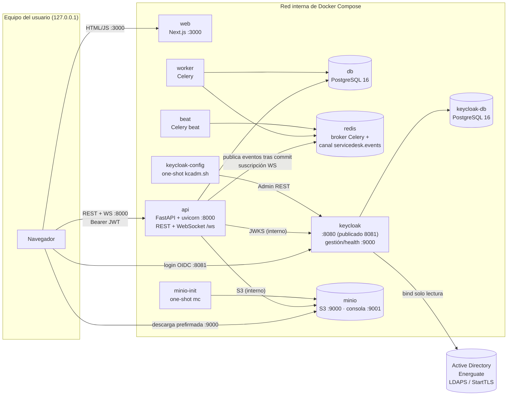
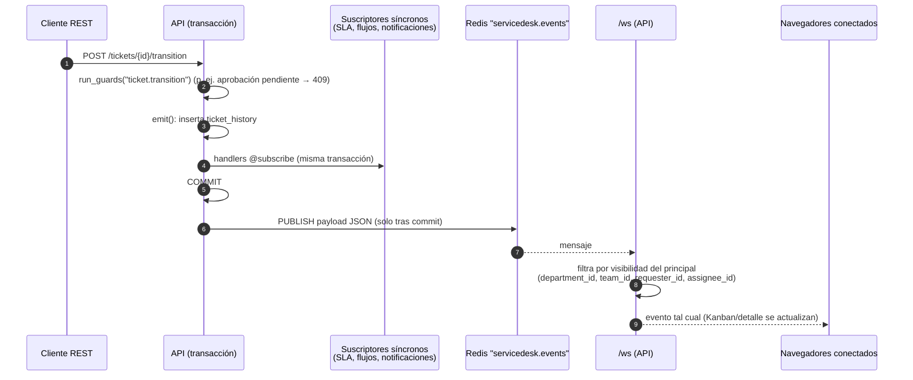

# Arquitectura — Fase 2

## Servicios



| Servicio | Imagen | Puerto host | Healthcheck | Depende de |
|---|---|---|---|---|
| `db` | postgres:16-alpine | — | `pg_isready` | — |
| `redis` | redis:7-alpine | — | `redis-cli ping` | — |
| `keycloak-db` | postgres:16-alpine | — | `pg_isready` | — |
| `keycloak` | quay.io/keycloak/keycloak:26.1 | 127.0.0.1:8081→8080 | `/health/ready` en :9000 (interno) | keycloak-db (healthy) |
| `keycloak-config` | quay.io/keycloak/keycloak:26.1 | — | one-shot | keycloak (healthy) |
| `minio` | Chainguard MinIO (digest fijo) | 127.0.0.1:9000, 127.0.0.1:9001 | `/minio/health/live` | — |
| `minio-init` | Chainguard minio-client (digest fijo) | — | one-shot | minio (healthy) |
| `api` | build `./backend` | 127.0.0.1:8000 | `GET /health` | db, redis (healthy), keycloak (started), minio-init (completado) |
| `worker` | build `./backend` | — | — | db, redis, api (healthy) |
| `beat` | build `./backend` | — | — | redis, api (healthy) |
| `web` | build `./frontend` | 127.0.0.1:3000 | `GET /` | api (healthy) |

`api`, `worker` y `beat` comparten la imagen `energuate-service-desk/backend:local`. El contenedor
`api` ejecuta al arrancar `alembic upgrade head`, los seeds idempotentes (`python -m app.seeds`) y
uvicorn; `worker` y `beat` esperan a que `api` esté sano para no competir con las migraciones.

Volúmenes persistentes: `db_data`, `kc_data`, `redis_data`, `minio_data`.

## Autenticación (OIDC)

Realm `energuate` (importado de `keycloak/realm-energuate.json` con `start-dev --import-realm`; si el
realm ya existe en `kc_data` no se reimporta).

- **`servicedesk-web`**: cliente público, Authorization Code + PKCE `S256` obligatorio, redirect URI
  `http://localhost:3000/*`, web origin `http://localhost:3000`. Sin direct access grants ni implicit.
  Mappers propios: audiencia `servicedesk-api` (access token) y `groups` (pertenencia a grupos, sin
  ruta completa, en access/ID token y userinfo).
- **`servicedesk-api`**: cliente confidencial sin ningún flujo habilitado; existe solo como audiencia.
- Rol por defecto `default-roles-energuate` → incluye `requester`.
- Sesiones: access token 5 min, inactividad SSO 30 min, sesión máxima 10 h. Protección contra fuerza
  bruta: 5 fallos → bloqueo temporal creciente (60 s hasta 15 min).

```mermaid
sequenceDiagram
    autonumber
    participant U as Navegador (web :3000)
    participant K as Keycloak (:8081)
    participant AD as Active Directory
    participant A as API (:8000)
    U->>K: /auth?client_id=servicedesk-web&code_challenge=…(S256)
    K->>AD: bind de la cuenta de servicio + búsqueda sAMAccountName
    K->>AD: bind con la contraseña del usuario (verificación)
    K-->>U: redirect http://localhost:3000/...?code=…
    U->>K: /token (code + code_verifier)
    K-->>U: access_token (iss=http://localhost:8081/realms/energuate, aud=servicedesk-api)
    U->>A: GET /me  Authorization: Bearer …
    A->>K: JWKS vía http://keycloak:8080/... (en caché)
    A->>A: valida firma, iss, exp, aud; upsert users (JIT);<br/>sincroniza team_members con groups ↔ teams.external_group
    A-->>U: {id, roles, teams, …}
```

Claims que consume la API: `sub`, `preferred_username`, `name`, `email`, `realm_access.roles`,
`groups` (ausente si el usuario no pertenece a ningún grupo: tratar como lista vacía).

`keycloak-js` usa `check-sso` con `silent-check-sso.html` y renueva el token antes de que expire.
`KC_HOSTNAME=http://localhost:8081` fija el `iss` de los tokens aunque la API acceda a Keycloak por la
red interna (`keycloak:8080`).

### Federación con Active Directory

`keycloak-config` (`keycloak/configure-ldap.sh`) crea o actualiza, de forma idempotente:

1. Usuarios de laboratorio (si `KC_LAB_USERS=true`).
2. Proveedor LDAP `energuate-ad` (vendor `ad`, `READ_ONLY`, `sAMAccountName`, `objectGUID`, RDN `cn`,
   paginación, sincronización periódica) y mapper `groups-ad` (`group-ldap-mapper`, `READ_ONLY`).
3. Prueba de conexión/bind y sincronización de grupos.
4. Asignación de roles de realm a grupos (`KC_GROUP_ROLE_MAP`).

Ver [`AD_INTEGRATION.md`](AD_INTEGRATION.md).

### Modo `dev`

Solo laboratorio: la API acepta `X-Dev-User`, `X-Dev-Roles` (csv) y `X-Dev-Groups` (csv) sin
verificación, y el portal muestra un selector de identidad. No requiere Keycloak.

## Autorización por área

- `admin`: todos los tickets.
- `agent`: tickets de sus equipos o departamentos, asignados a él o creados por él.
- `approver`: los suyos + los que tienen una aprobación dirigida a él.
- `requester`: solo los propios. Los comentarios `internal` solo los ven agentes y administradores.

La regla se implementa una sola vez en `backend/app/core/permissions.py` y se reutiliza en REST,
WebSocket y reportes.

## Eventos y tiempo real



Payload: `{"type", "ticket_id", "ticket_key", "actor_id", "data", "ts", "department_id", "team_id",
"requester_id", "assignee_id"}`. Eventos de la fundación: `ticket.created`, `ticket.updated`,
`ticket.assigned`, `ticket.transitioned`, `ticket.commented`; los módulos añaden `sla.warning`,
`sla.breached`, `approval.requested`, `approval.decided`, `attachment.added`,
`notification.created`.

WebSocket: `GET /ws?token=<jwt>` (modo dev: `?dev_user=&dev_roles=&dev_groups=`), ping cada 25 s.

Tareas periódicas (Celery beat): cada módulo declara `beat_schedule` en `app/tasks/<módulo>.py`
(p. ej. revisión de vencimientos de SLA cada minuto).

## Adjuntos

`minio-init` crea el bucket privado `S3_BUCKET` y una cuenta de servicio (`S3_ACCESS_KEY`) con una
política limitada a ese bucket; las credenciales root de MinIO no llegan a la API. La API sube los
archivos por la red interna (`S3_ENDPOINT=http://minio:9000`) y genera URLs prefirmadas de corta
duración firmadas para `S3_PUBLIC_ENDPOINT=http://localhost:9000`, que el navegador descarga
directamente.

## Límites conocidos

- Keycloak en `start-dev` (HTTP) y puertos solo locales: no apto para exposición en red sin TLS.
- Sin alta disponibilidad: una instancia de cada servicio.
- Sin copias de seguridad automatizadas (PostgreSQL ×2 y MinIO).
