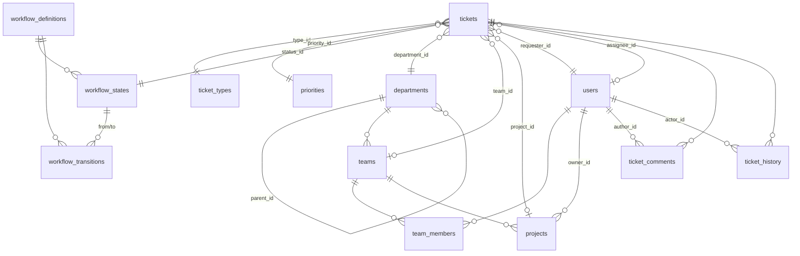
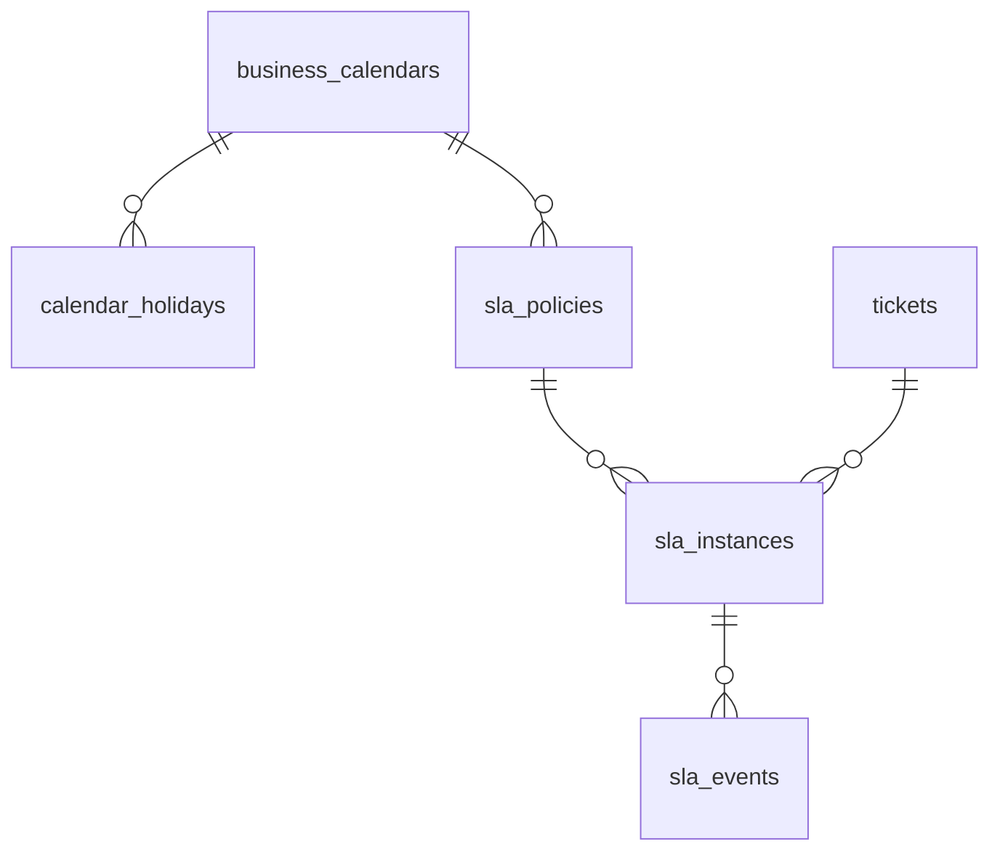
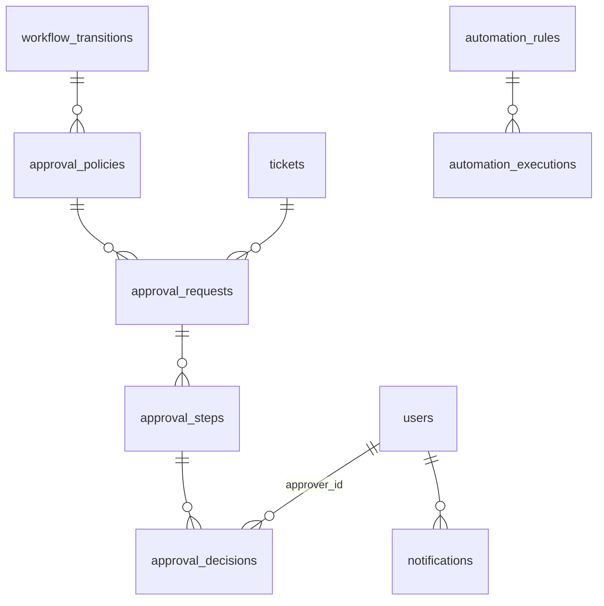
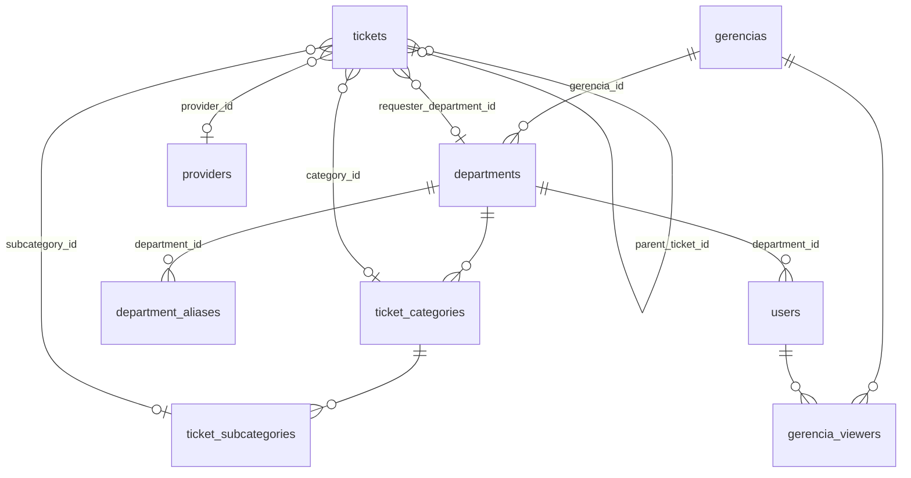

# Modelo de datos

PostgreSQL 16 (base `servicedesk`) gestionada con **Alembic**. Los modelos SQLAlchemy viven en
`backend/app/models/` y usan tipos portables (`JSON`, fechas con zona horaria siempre en UTC) para que
las pruebas corran sobre SQLite. Las fechas se guardan en UTC; el negocio (SLA, reportes) las
interpreta en `TZ_BUSINESS=America/Guatemala`.

## Migraciones

| Revisión | Anterior | Módulo | Tablas |
|---|---|---|---|
| `0001_core` | — | core | `users`, `departments`, `teams`, `team_members`, `projects`, `ticket_types`, `priorities`, `workflow_definitions`, `workflow_states`, `workflow_transitions`, `tickets`, `ticket_comments`, `ticket_history` (+ renombra las tablas de la Fase 1 `tickets`, `comments`, `audit_events` a `legacy_*` si existen) |
| `0002_sla` | `0001_core` | sla | `business_calendars`, `calendar_holidays`, `sla_policies`, `sla_instances`, `sla_events` |
| `0003_flows` | `0002_sla` | flows | `approval_policies`, `approval_requests`, `approval_steps`, `approval_decisions`, `automation_rules`, `automation_executions`, `notifications` |
| `0004_attachments` | `0003_flows` | attachments | `ticket_attachments` |
| `0005_seed_state` | `0004_attachments` | core | `seed_state` |
| `0006_catalog` | `0005_seed_state` | catálogo (Fase 3) | `gerencias`, `department_aliases`, `ticket_categories`, `ticket_subcategories`, `providers`, `gerencia_viewers` + columnas nuevas en `departments`, `users`, `ticket_types`, `tickets` y `sla_policies` |
| `0007_report_templates` | `0006_catalog` | reportes (Fase 3) | `report_templates` |
| `0008_phase3_fixes` | `0007_report_templates` | correcciones (Fase 3) | columnas `users.ad_department_value` y `report_templates.retry_count` |

El contenedor `api` ejecuta `alembic upgrade head` y los seeds idempotentes (`python -m app.seeds`,
orden alfabético: `00_core`, `10_sla`, `20_flows`, `40_report_templates`, `90_core_demo`,
`95_catalog_demo`) en cada arranque. Los datos
iniciales editables (departamentos y equipos, calendarios y políticas SLA, ejemplos de flujos) se
crean una sola vez: la marca queda en `seed_state` (`key` PK, `applied_at`, `data` JSON con, p. ej.,
el id del calendario cuyos feriados se mantienen) y los arranques siguientes no los recrean aunque el
administrador los renombre o borre.

## Diagrama (core)

## Tablas core (`0001_core`)

### `users`
| Columna | Tipo | Notas |
|---|---|---|
| `id` | int PK | |
| `keycloak_sub` | varchar(255) **único** | `sub` del token (= `objectGUID` para usuarios de AD); `dev:<usuario>` en modo dev |
| `username` | varchar(150), índice | `preferred_username` (sAMAccountName) |
| `display_name` | varchar(200) | `name` del token |
| `email` | varchar(255) nulo | |
| `roles` | JSON (lista) | Roles de realm del último login; permite `GET /users?role=` |
| `department_id` | FK `departments` nulo, índice | Departamento del usuario según el atributo `department` del AD (resuelto con `department_aliases`); el administrador puede fijarlo a mano y el siguiente login con claim `department` lo vuelve a resolver |
| `vip` | bool (false) | Miembro del grupo `VIP_GROUP` (se actualiza en cada login si el token trae `groups`) |
| `ad_department_value` | varchar(200) nulo, índice | Último valor normalizado del claim `department`. Si cambia a un valor pendiente se retira `department_id`; si no cambia se respeta el ajuste manual. Al asignar un alias se actualizan al instante los usuarios con ese valor (`0008_phase3_fixes`) |
| `active` | bool | |
| `created_at`, `last_login_at` | timestamptz | |

Provisión JIT: la API hace *upsert* por `keycloak_sub` en cada petición autenticada.

### `departments`
`id`, `name` (único), `parent_id` → `departments.id` (SET NULL), `gerencia_id` → `gerencias` (nulo, SET
NULL, índice), `serves_tickets` (bool: `true` = departamento **de atención**, recibe tickets; `false` = solo
departamento **solicitante**, p. ej. Comercial), `active` (bool). La migración `0006` deja
`serves_tickets=true` en los departamentos existentes. Seeds: Telecomunicaciones, Seguridad de Redes,
Ciberseguridad / SOC, Riesgo y Cumplimiento, Proyectos TI, General (`core.departments.v1`) y, en la
Fase 3, Sistemas Comerciales, Sistemas Corporativos, Telecomunicaciones, Seguridad Informática y Soporte
Técnico, cada uno con su «Equipo <nombre>» (`core.departments.v2`, una sola vez).

### `teams`
`id`, `department_id` → `departments`, `name` (único por departamento), `external_group` (nombre del
grupo AD/Keycloak; índice). Seed: un equipo por departamento con el grupo de `SEED_TEAM_GROUPS`.

### `team_members`
PK (`team_id`, `user_id`), `role` ∈ {`member`, `lead`} (CHECK). Borrado en cascada con el equipo o
el usuario. Se sincroniza con el claim `groups` para los equipos con `external_group`.

### `projects`
`id`, `code` (único), `name`, `owner_id` → `users` (nulo), `team_id` → `teams` (nulo).

### `ticket_types`, `priorities`
- `ticket_types`: `id`, `key` (único), `name`, `active`. Seeds: `incident`, `service_request`, `change`,
  `problem`; en la Fase 3 (`core.ticket_types.v2`, una vez) `incident` → «Incidencia», `service_request` →
  «Petición», nuevo `work_order` → «Orden de trabajo», y `change`/`problem` quedan inactivos (no se borran;
  los tickets antiguos los conservan, pero no se pueden crear tickets nuevos de un tipo inactivo).
- `priorities`: `id`, `key` (único), `name`, `rank`. Seeds: `low`=1, `medium`=2, `high`=3, `critical`=4.

### `workflow_definitions`, `workflow_states`, `workflow_transitions`
- `workflow_definitions`: `id`, `key` (único), `name`, `is_default`.
- `workflow_states`: `id`, `workflow_id`, `key` (único por workflow), `name`, `category` ∈ {`todo`,
  `in_progress`, `waiting`, `done`} (CHECK), `order`, `is_initial`, `is_final`.
- `workflow_transitions`: `id`, `workflow_id`, `from_state_id`, `to_state_id` (ruta única por
  workflow), `name`, `requires_approval`.

Workflow por defecto: `new` → `triage` → `assigned` → `in_progress` ⇄ `pending` → `resolved` →
`closed`, con reapertura `resolved` → `in_progress`.

### `tickets`
| Columna | Tipo | Notas |
|---|---|---|
| `id` | int PK | |
| `public_key` | varchar(30) único | `ESD-<id>` |
| `title`, `description` | varchar(200), text | |
| `project_id`, `type_id`, `priority_id`, `status_id`, `department_id`, `team_id` | FK | `status_id`, `department_id`, `team_id` indexados |
| `requester_id`, `assignee_id` | FK `users` | indexados |
| `created_at` (índice), `updated_at` | timestamptz | |
| `first_response_at` | timestamptz | Primer comentario público de un agente distinto del solicitante o primera transición fuera de `new` por un agente |
| `resolved_at`, `closed_at` | timestamptz | |
| `category_id`, `subcategory_id` | FK `ticket_categories` / `ticket_subcategories` nulos, índice | Clasificación del departamento de atención (Fase 3) |
| `provider_id` | FK `providers` nulo, índice | Proveedor externo que atendió (lo fija un agente) |
| `channel` | varchar(20), CHECK `portal`, `email`, `phone`, `other` | Canal de entrada; el del solicitante siempre es `portal` |
| `vip` | bool | Copia de `users.vip` del solicitante al crear el ticket |
| `resolution_note` | text nulo | Solución; obligatoria para resolver |
| `resolved_by_id` | FK `users` nulo | Quién lo resolvió (se limpia al reabrir) |
| `requester_department_id` | FK `departments` nulo, índice | Departamento del solicitante al crear el ticket (de él sale la gerencia solicitante) |
| `parent_ticket_id` | FK `tickets` nulo, índice | Ticket original de una orden de trabajo |
| `business_resolution_minutes` | int nulo | Minutos **hábiles** de resolución: los de la instancia SLA de resolución (descuenta pausas) o, sin SLA, los del calendario hábil por defecto entre `created_at` y `resolved_at`. Base de las métricas de horas de los reportes |

### `ticket_comments`
`id`, `ticket_id` (CASCADE, índice), `author_id`, `body`, `visibility` ∈ {`public`, `internal`}
(CHECK), `created_at`. Los `internal` solo los ven agentes y administradores.

### `ticket_history`
`id`, `ticket_id` (CASCADE, índice), `actor_id` (nulo = sistema), `event_type` (índice),
`before_json`, `after_json` (JSON), `timestamp` (índice). Lo escribe `core/events.emit()` para cada
evento (`ticket.created`, `ticket.updated`, `ticket.assigned`, `ticket.transitioned`,
`ticket.commented`, y los de los módulos). Es la pista de auditoría de la aplicación.

## SLA (`0002_sla`)

| Tabla | Columnas principales |
|---|---|
| `business_calendars` | `id`, `name` (único), `description`, `timezone` (America/Guatemala), `windows` JSON `[{weekday 0-6 (0=lunes), start "HH:MM", end "HH:MM"}]`, `created_at`, `updated_at` |
| `calendar_holidays` | `id`, `calendar_id` (CASCADE), `date`, `name`, `recurring` (se repite cada año); único (`calendar_id`, `date`) |
| `sla_policies` | `id`, `name` (único), `calendar_id`, filtros JSON `priority_keys`, `type_keys`, `department_ids`, `category_ids`, `subcategory_ids` (vacío = todos) y `vip_only` (bool), `precedence` (se evalúa primero la más específica: subcategoría > categoría > resto; dentro del mismo nivel, menor precedencia = antes), `first_response_minutes`, `resolution_minutes` (minutos hábiles), `warning_threshold_pct`, `pause_categories`, `pause_states` (JSON), `active` |
| `sla_instances` | `id`, `ticket_id` (CASCADE), `policy_id`, `calendar_id`, `metric` ∈ {`first_response`, `resolution`}, `target_minutes`, `warning_threshold_pct`, `started_at`, `target_at`, `warning_at`, `paused_at`, `paused_business_seconds`, `stopped_at`, `breached_at`, `warned_at`, `status` ∈ {`running`, `paused`, `met`, `breached`, `cancelled`}. Índices (`ticket_id`, `metric`), (`status`, `target_at`), (`status`, `warning_at`) |
| `sla_events` | `id`, `instance_id` (CASCADE), `type` (`started`, `paused`, `resumed`, `warning`, `breached`, `met`, `stopped`, `cancelled`, `recalculation`…), `at`, `data` JSON |

Las métricas se calculan por eventos (suscriptores de `ticket.*`): las pausas por categoría/estado
descuentan tiempo hábil; Celery beat (`sla.check_deadlines`, cada 60 s) emite `sla.warning` y
`sla.breached`.

## Flujos (`0003_flows`)

| Tabla | Columnas principales |
|---|---|
| `approval_policies` | `id`, `name`, `active`, `transition_id` (CASCADE; transición que exige aprobación), filtros `ticket_type_keys`, `department_ids`, `steps` JSON (plantilla de etapas), `order` |
| `approval_requests` | `id`, `ticket_id` (CASCADE), `transition_id`, `policy_id`, `status` ∈ {`pending`, `approved`, `rejected`, `cancelled`}, `requested_by_id`, `reason`, `created_at`, `decided_at`, `executed_at`, `execution_error`. Índice (`ticket_id`, `status`) |
| `approval_steps` | `id`, `request_id` (CASCADE), `order`, `name`, `approver_type` ∈ {`user`, `role`, `team`, `team_lead`}, `approver_user_id` / `approver_role` / `approver_team_id` / `approver_department_id`, `rule` ∈ {`all`, `any`}, `status` ∈ {`waiting`, `pending`, `approved`, `rejected`, `cancelled`}, `decided_at` |
| `approval_decisions` | `id`, `step_id` (CASCADE), `approver_id`, `decision` ∈ {`pending`, `approved`, `rejected`, `skipped`}, `comment`, `is_override`, `created_at`, `decided_at`. Índice (`approver_id`, `decision`) |
| `automation_rules` | `id`, `name`, `description`, `active`, `trigger` (tipo de evento, índice), `conditions` JSON, `actions` JSON (lista), `order`, `stop_processing`, `created_by_id` |
| `automation_executions` | `id`, `rule_id`, `ticket_id`, `event_type`, `history_id`, `depth` (protección contra bucles), `status` ∈ {`success`, `partial`, `error`}, `result` JSON, `error`, `created_at` |
| `notifications` | `id`, `user_id` (CASCADE), `kind`, `title`, `body`, `ticket_id`, `data` JSON, `channel` ∈ {`in_app`, `email`}, `is_read`, `read_at`, `delivery_status` ∈ {`delivered`, `pending`, `sent`, `failed`, `skipped`}, `attempts`, `last_error`, `sent_at`, `created_at`. Índices bandeja (`user_id`, `channel`, `is_read`) y entrega (`channel`, `delivery_status`) |

Los aprobadores ven los tickets con aprobaciones dirigidas a ellos mediante una extensión de
visibilidad (`register_visibility_extension`). El guard `ticket.transition` bloquea (409) las
transiciones con `requires_approval` hasta que la solicitud se aprueba. Los correos pendientes se
reintentan cada 5 min (`notifications.retry_pending`).

## Adjuntos (`0004_attachments`)

| Columna | Tipo | Notas |
|---|---|---|
| `id` | int PK | |
| `ticket_id` | FK `tickets` (CASCADE) | índice (`ticket_id`, `deleted_at`) |
| `object_key` | varchar(255) único | Clave del objeto en el bucket `S3_BUCKET` |
| `filename`, `mime` | varchar | Nombre original y tipo MIME |
| `size` | bigint (≥ 0) | Bytes; límite `MAX_ATTACHMENT_MB` |
| `checksum` | varchar(64) | SHA-256 del contenido |
| `uploaded_by` | FK `users` | índice |
| `created_at`, `deleted_at` | timestamptz | Borrado lógico |

El contenido vive en MinIO/S3; la API sube y sirve los archivos (proxy en *streaming*) tras verificar
la visibilidad del ticket, de modo que el bucket nunca se expone al navegador.

## Catálogo de servicio (`0006_catalog`)

| Tabla | Columnas principales |
|---|---|
| `gerencias` | `id`, `name` (único, 150), `external_group` (grupo AD cuyos miembros ven **en solo lectura** los tickets **solicitados** por los departamentos de la gerencia), `active` |
| `department_aliases` | `id`, `normalized_value` (único, 200), `raw_value`, `department_id` (nulo = **pendiente** de asignar por el administrador), `created_at`. Traduce el atributo `department` del AD a un departamento |
| `ticket_categories` | `id`, `department_id` (índice), `name`, `type_keys` JSON (tipos admitidos; vacío = todos), `active`, `sort_order`. Único (`department_id`, `name`) |
| `ticket_subcategories` | `id`, `category_id` (CASCADE, índice), `name`, `active`, `sort_order`. Único (`category_id`, `name`) |
| `providers` | `id`, `name` (único), `department_ids` JSON (departamentos de atención donde aplica; vacío = todos), `active` |
| `gerencia_viewers` | PK (`gerencia_id`, `user_id`): asignación manual de visores de una gerencia (además del grupo AD) |

Normalización del valor del AD (`app/core/catalog.py::normalize_ad_value`): sin espacios sobrantes,
mayúsculas, sin tildes y sin prefijo numérico (`"07 Comercial"` → `COMERCIAL`). Un valor nuevo crea el
alias: si coincide exactamente con el nombre normalizado de un departamento queda asignado; si no, queda
pendiente (evento `catalog.alias_pending`, visible para administradores en **Administración → Valores del
AD**).

Reglas de clasificación: la categoría debe estar activa, pertenecer al departamento del ticket y admitir su
tipo; la subcategoría debe ser de la categoría; el proveedor, activo y aplicable al departamento. Para
resolver un ticket hace falta la solución (`resolution_note`) y, si el departamento tiene categorías
activas y quien resuelve atiende el ticket, la categoría. «Trasladar a orden de trabajo» crea un ticket
`work_order` hijo (`parent_ticket_id`) y, opcionalmente, resuelve el original.

## Reportes (`0007_report_templates`)

| Tabla | Columnas principales |
|---|---|
| `report_templates` | `id`, `name`, `description`, `owner_id` (nulo = de fábrica), `is_system`, `definition` JSON (definición del generador: periodo, filtros, secciones), `shared_roles` JSON, `shared_department_ids` JSON, `schedule` JSON (`enabled`, `frequency` mensual o semanal, `day`, `hour`, `recipients`), `next_run_at` (índice), `last_run_at`, `last_status` (`sent`, `smtp_disabled`, `owner_inactive`, `owner_stale`, `not_allowed`, `no_recipients`, `invalid_definition`, `retrying`, `error`), `retry_count` (reintentos tras error, `0008_phase3_fixes`), `created_at`, `updated_at` |

Los reportes no guardan datos calculados: cada ejecución consulta los tickets visibles para quien la
ejecuta (o, en un envío programado, para el dueño de la plantilla). Ver [REPORTS.md](REPORTS.md).

## Tablas heredadas

`legacy_tickets`, `legacy_comments`, `legacy_audit_events`: datos de la Fase 1 (MVP) renombrados por
`0001_core` si existían. No los usa la aplicación; se conservan para migración manual o consulta y
pueden eliminarse tras validarlos.

## Base de datos de Keycloak

La base `keycloak` (contenedor `keycloak-db`) pertenece a Keycloak y la migra el propio Keycloak al
actualizarse. No se accede a ella desde la aplicación; se respalda junto con la de la aplicación
(`scripts/backup.sh`).

## Evolución prevista

- `assets`, `asset_ticket_links` (CMDB) en una migración futura (`0008_*` o posterior).
- Nuevas migraciones: siempre encadenadas al `head` vigente, con `upgrade` y `downgrade`, y
  probadas en CI (`alembic upgrade head` → `downgrade base` → `upgrade head`).
